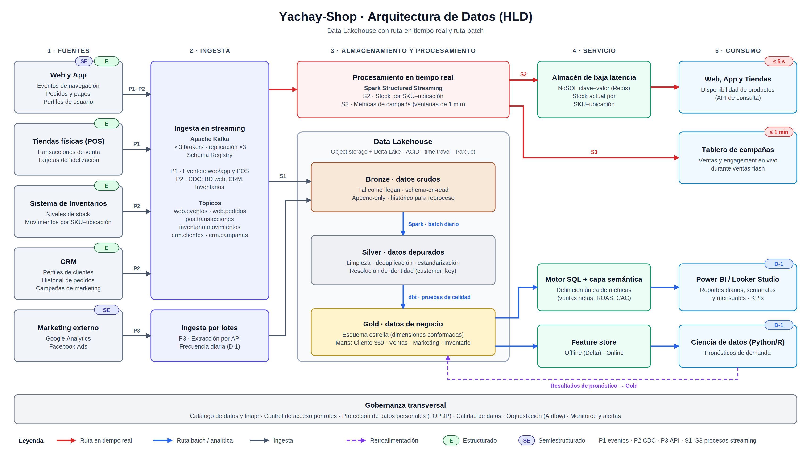

# Arquitectura de Datos para Yachay-Shop (HLD)

**Universidad Yachay Tech · Maestría en Ciencia de Datos**
Fundamentos de Ciencia de Datos · Taller 04: Diseño de Arquitectura de Datos para un E-Commerce

> El diagrama fue elaborado en **draw.io** ([diagrams.net](https://app.diagrams.net)).

---

## Contexto

Yachay-Shop es un e-commerce de tamaño medio que vende por tres canales: web, app móvil y tiendas físicas. Sus datos residen en sistemas aislados (web/app, POS, CRM, inventarios y marketing externo), lo que genera tres problemas:

- **Silos de datos:** no existe una visión integrada del cliente ni del negocio.
- **Volumen y variedad:** coexisten datos estructurados y semiestructurados.
- **Latencia:** se requiere información en tiempo real durante campañas y ventas flash.

## Propuesta

Un **Data Lakehouse** con dos rutas de procesamiento:

| Ruta | Color en el diagrama | Latencia | Uso |
|---|---|---|---|
| Tiempo real | Rojo | ≤ 5 s / ≤ 1 min | Inventario entre canales, monitoreo de campañas |
| Batch / analítica | Azul | D-1 | Vista 360, reportes, marketing, pronósticos |

## Componentes

### 1. Fuentes

| Fuente | Datos | Tipo |
|---|---|---|
| Web y App | Navegación, pedidos, perfiles | Estructurado + semiestructurado |
| Tiendas (POS) | Ventas, fidelización | Estructurado |
| Inventarios | Stock y movimientos por SKU–ubicación | Estructurado |
| CRM | Clientes, pedidos, campañas | Estructurado |
| Marketing externo | Google Analytics, Facebook Ads | Semiestructurado |

### 2. Ingesta

- **P1 · Eventos:** web/app y POS publican en Apache Kafka.
- **P2 · CDC (Change Data Capture):** captura de cambios de las bases de datos de web, CRM e inventarios hacia Kafka.
- **P3 · API por lotes:** extracción diaria de las métricas de marketing externo.

### 3. Almacenamiento y procesamiento

**Lakehouse** sobre almacenamiento de objetos con **Delta Lake** (ACID, *time travel*, Parquet), organizado en tres capas:

| Capa | Contenido |
|---|---|
| **Bronze** | Datos crudos, *schema-on-read*, histórico para reproceso |
| **Silver** | Datos depurados, deduplicados y con resolución de identidad del cliente (`customer_key`) |
| **Gold** | Esquema estrella y data marts: Cliente 360, Ventas, Marketing, Inventario |

El procesamiento usa dos motores según la ruta:

- **Streaming:** Spark Structured Streaming. S2 calcula el stock en tiempo real; S3 calcula métricas de campaña por minuto.
- **Batch:** Spark + dbt, orquestado con Airflow en un proceso diario con pruebas de calidad.

### 4. Servicio

- **Almacén de baja latencia (NoSQL / Redis):** stock actual para web, app y tiendas.
- **Motor SQL + capa semántica:** métricas de negocio con definición única.
- **Feature store:** variables para modelos predictivos.

### 5. Consumo

- **Web, App y Tiendas:** disponibilidad de productos (≤ 5 s).
- **Tablero de campañas:** ventas y engagement en vivo (≤ 1 min).
- **Power BI / Looker Studio:** reportes diarios, semanales y mensuales.
- **Ciencia de datos (Python/R):** pronósticos de demanda; los resultados regresan a Gold.

### Gobernanza transversal

Catálogo de datos y linaje · control de acceso por roles · protección de datos personales (LOPDP) · calidad de datos · orquestación · monitoreo.

## Necesidades del negocio cubiertas

| Necesidad | Dónde se resuelve |
|---|---|
| Vista 360 del cliente | Resolución de identidad en Silver + mart Cliente 360 |
| Inventario en tiempo real | Ruta roja: Kafka → Spark Streaming → Redis → canales |
| Eficacia del marketing | Cruce de campañas y ventas en Gold |
| Reportes y pronósticos | Ruta azul: Gold → BI y feature store → ciencia de datos |

## Escalabilidad

Almacenamiento y cómputo están separados, por lo que cada capa escala de forma independiente:

- **Kafka:** se agregan particiones y brokers.
- **Spark:** se agregan nodos.
- **Almacenamiento en la nube:** crece sin límite práctico.

Con un crecimiento supuesto del 50 % anual, los picos pasarían de ~460 a ~1.000 eventos/s en tres años sin cambiar la arquitectura.

## Supuestos principales

Los volúmenes son hipotéticos, porque el taller no los especifica:

- ~200.000 sesiones diarias y ~4 millones de eventos de navegación al día.
- 30 tiendas, 3 almacenes y ~20.000 SKU.
- Picos de 10× durante campañas.
- Crecimiento anual del 50 %.

## Tecnologías de referencia

Apache Kafka · Delta Lake · Apache Spark · dbt · Apache Airflow · Redis · Power BI / Looker Studio · Python / R
